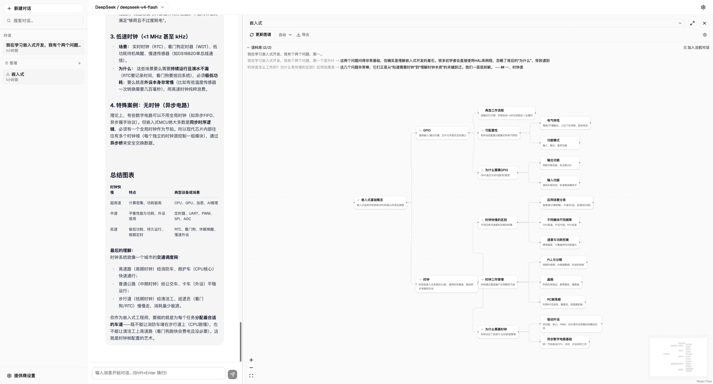
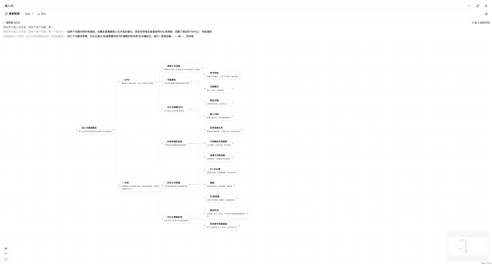

<p align="center">
  <h1 align="center">🧠 Progressive Mindmap</h1>
  <p align="center">
    <strong>AI-powered knowledge extraction from conversations — visualized as mindmaps</strong>
  </p>
  <p align="center">
    <a href="README.zh-CN.md">中文文档</a>
  </p>
  <p align="center">
    
    
    
    
    
    
  </p>
</p>

---

> **Why I built this**: After countless conversations with LLMs, I found myself drowning in insights — brilliant answers buried in long chat histories, impossible to review or recall. I needed a way to automatically distill conversations into structured knowledge I could revisit at a glance. That's why Progressive Mindmap exists: it turns scattered Q&A into a living mindmap that grows with every conversation.

Progressive Mindmap is a **local-first desktop application** built with Electron and a React 18 renderer. It transforms your LLM conversations into structured, editable mindmaps. Unlike traditional mindmap tools where you draw nodes manually, Progressive Mindmap **extracts knowledge automatically**: chat with any OpenAI-compatible LLM and let the AI build a mindmap — with **incremental updates** that preserve your edits across regenerations.

<p align="center">
  
</p>

## ✨ Features

### 🤖 AI-Native Mindmap Generation

- **Conversation to Knowledge Graph** — the LLM analyzes your chats and produces structured trees
- **Incremental Operations** — the AI emits surgical edits (`add_child`, `update`, `delete_leaf`, `add_root`, `reparent`) instead of regenerating the whole tree, preserving human edits via the `editedByUser` flag
- **Streaming Preview** — watch the mindmap build in real-time during generation with shimmer animations
- **Per-Node Agent Chat** — dive deeper into any node by entering a scoped LLM conversation that can query and update nodes via the built-in agent subsystem

### 📚 Conversation Corpus

- **Conversation Monitoring** — tracked conversations feed new AI responses into the mindmap corpus automatically

### 🎨 Canvas & Interaction

- **React Flow Canvas** — smooth pan/zoom with `@xyflow/react` + dagre tree layout
- **Drag-to-Reparent** — restructure your mindmap by dragging nodes onto new parents
- **Right-Click Menu** — add child, move, delete, reparent with context menu
- **Collapse/Expand** — toggle branches for focused viewing
- **Drill-Down Mode** — enter any sub-tree with breadcrumb navigation to focus on a specific branch
- **Back-to-Global Navigation** — when viewing a conversation-linked mindmap, a toolbar button returns you to the global tree view
- **Outline Panel** — hierarchical tree view sidebar, navigate and select nodes at a glance
- **Full-Screen Mode** — immersive mindmap exploration
- **Single Node Style** — every node renders as one readable rect card (the multi-shape switcher was removed; legacy shape data still loads)
- **MiniMap** — bird's-eye viewport for navigating large mindmaps

<p align="center">
  
</p>

### 🔍 Search & Filter

- **Full-Text Search** — search across all node labels and content with match highlighting
- **Depth Filter** — inline slider to control visible tree depth
- **Hover Path Highlight** — hover a node to highlight its ancestry path through the tree

### ⚙️ Customizable

- **Organization Patterns** — auto / 5W1H / tech / pros-cons decide how new knowledge is organised and tint the canvas
- **Canvas Background** — dots / grid / blank
- **Multi-Provider** — works with OpenAI, DeepSeek, Ollama, SiliconFlow, and any OpenAI-compatible API
- **Per-Mindmap Model** — different mindmaps can use different models for generation
- **Node Icons** — auto-assigned icons based on content type and depth

### 📝 Rich Node Content

- **Bottom Drawer Editor** — edit node content in a resizable, in-canvas bottom drawer with drag handles
- **HTML Node Content** — node content is stored and rendered as HTML after DOMPurify sanitization (chat messages still render Markdown)
- **Auto-Format** — HTML content is beautified on save and generation
- **Export** — export your mindmap as PNG, SVG, or Markdown

### ⏪ Undo / Redo

- Undo / redo for user edits (AI-applied operations are not recorded in the undo stack yet)

### 💾 Local-First & Private

- **IndexedDB Storage** — all data stays on your device (IndexedDB database `progressive-mindmap`)
- **No Backend** — direct API calls from the renderer process
- **No Account Required** — you own your data

### 🖥️ Desktop App (Electron)

- Cross-platform desktop builds: macOS `.dmg`, Windows NSIS installer + portable `.exe`, Linux `.AppImage`
- Electron security baseline: `nodeIntegration: false`, `contextIsolation: true`, `sandbox: true`
- Typed `window.api` preload bridge — Phase-0 scaffolding reserved for Phase 1 native features; the renderer does not call it yet
- Auto-update is reserved for Phase 1 — current releases do not check for or install updates

## 🏗️ Architecture

Electron shell: the **main process** owns windows, menus and IPC; the **preload** script exposes a typed `window.api`; the **renderer** is the React 18 UI, sandboxed with no Node access. The diagram below shows the renderer-side layers.

```
┌─────────────────────────────────────────────────────────┐
│                    UI Layer (React 18)                   │
│  ┌───────────┐  ┌────────────┐  ┌───────────────────┐  │
│  │  Chat     │  │ Sidebar    │  │   Mindmap Panel    │  │
│  │  Interface│  │ (Sessions, │  │  ┌─────────────┐  │  │
│  │  Stream-  │  │  Mindmaps) │  │  │ React Flow  │  │  │
│  │  ing +    │  │            │  │  │ Canvas      │  │  │
│  │  Markdown │  │            │  │  │ + dagre     │  │  │
│  └───────────┘  └────────────┘  │  ├─────────────┤  │  │
│                                  │  │ Outline     │  │  │
│                                  │  │ Search      │  │  │
│  ┌───────────┐  ┌────────────┐  │  │ Filter      │  │  │
│  │Provider   │  │Conversation│  │  │ Drawer      │  │  │
│  │Settings   │  │Sidebar     │  │  │ (Node Edit) │  │  │
│  └───────────┘  └────────────┘  │  └─────────────┘  │  │
│  ┌────────────────────────────────────────────────┐  │
│  │ Agent Activity Panel (status + streaming chat) │  │
│  └────────────────────────────────────────────────┘  │
├─────────────────────────────────────────────────────────┤
│                 State Layer (Zustand)                    │
│  ┌───────────┐  ┌───────────┐  ┌───────────┐  ┌──────┐ │
│  │ Provider  │  │Conversation│  │ MindMap   │  │ Chat │ │
│  │ Store     │  │  Store     │  │ Store     │  │Store │ │
│  └───────────┘  └───────────┘  └───────────┘  └──────┘ │
│        └─────────────── IndexedDB (idb) ─────────────┘  │
├─────────────────────────────────────────────────────────┤
│          Incremental Generation (Agent Tools)            │
│  ┌───────────┐  ┌───────────┐  ┌─────────────────────┐ │
│  │ Mindmap   │→ │ generate  │→ │ OpenAI-compatible    │ │
│  │ context   │  │ MindmapOps│  │ LLM API              │ │
│  │ + recent  │  │ (Zod)     │  │                      │ │
│  └───────────┘  └───────────┘  └─────────────────────┘ │
│                                     ↓                    │
│  ┌───────────┐  ┌───────────┐  ┌─────────────────────┐ │
│  │ update    │← │ apply     │← │ Zod-validated ops    │ │
│  │ updateTree│  │ Operations│  │ (add_child, update,  │ │
│  │ (store)   │  │           │  │  delete_leaf, ...)   │ │
│  └───────────┘  └───────────┘  └─────────────────────┘ │
├─────────────────────────────────────────────────────────┤
│               Agent Subsystem (Worker)                   │
│  ┌───────────┐  ┌───────────┐  ┌─────────────────────┐ │
│  │ ReAct     │→ │ Zod-      │→ │ Tool Execution      │ │
│  │ Runner    │  │ validated │  │ (read node, query,   │ │
│  │ (WebWorker)│  │ schemas   │  │  reparent, update)  │ │
│  └───────────┘  └───────────┘  └─────────────────────┘ │
└─────────────────────────────────────────────────────────┘
```

There is a single write funnel: agent tools produce `generateMindmapOps` calls → Zod validation → `applyOperations` → `useMindmapStore.updateMindmapTree`. Context sent to the agent is a flattened tree (`mindmapTreeToFlatContext`, capped at 200 nodes) plus the most recent messages (6 for enhancement, 4 for mediate mode).

### Project Structure

```
electron/
├── main/               # Main process: window, menu, IPC, updater stub
├── preload/            # `window.api` contextBridge (Phase-0 scaffolding)
└── shared/             # IPC channel + payload types shared by both
src/
├── features/
│   ├── chat/           # Chat interface, message bubbles, input
│   ├── conversation/   # Conversation sidebar & management
│   ├── mindmap/        # Mindmap panel, outline, search, drawer, filter
│   └── provider/       # API provider settings
├── components/
│   ├── flow-shell/     # React Flow canvas, nodes, edges, MiniMap, drill breadcrumb
│   └── ui/             # Shared UI primitives (shadcn/ui)
├── hooks/              # React hooks: theme, history, hotkeys, agent, resize
├── lib/
│   ├── agent/          # ReAct runner, agent tools, Zod schemas, worker protocol
│   └── ...             # db, export, layout, search, sanitizer, shapes
├── stores/             # Zustand stores (provider, conversation, mindmap, chat)
├── types/              # TypeScript type definitions
└── workers/            # WebWorker entry points (agent)
```

## 🚀 Quick Start

### Prerequisites

- Node.js 18+
- An API key from any OpenAI-compatible provider (OpenAI, DeepSeek, Ollama, SiliconFlow, etc.)

### Install & Run

```bash
git clone https://github.com/web4zn/progressive-mindmap.git
cd progressive-mindmap
npm ci
npm run dev
```

`npm run dev` starts the Electron app window directly (main + preload + renderer with HMR). Add your API provider in Settings and start chatting. Create a mindmap from the sidebar to begin extracting knowledge!

### Build

```bash
npm run build       # npm run typecheck + electron-vite build → out/{main,preload,renderer}
npm run preview     # Preview the production build via electron-vite
```

## 🧪 Development

```bash
npm test              # Run unit & component tests (vitest)
npm run typecheck     # Full type check: renderer (tsc --noEmit) + electron tsconfig
npm run lint          # ESLint (TypeScript + react-hooks + react-refresh)
npm run format        # Prettier (no semi, single quotes, trailing commas)
npm run smoke:electron # Main-process smoke test (scripts/smoke-electron.mjs)
```

### CI Pipelines

| Workflow                                                  | Trigger                 | Checks                                                                                                                                                                                                                     |
| --------------------------------------------------------- | ----------------------- | -------------------------------------------------------------------------------------------------------------------------------------------------------------------------------------------------------------------------- |
| **CI** (`.github/workflows/ci.yml`)                       | Push / PR to `main`     | `npm ci → tsc --noEmit → eslint → npm test`                                                                                                                                                                                |
| **Build Desktop** (`.github/workflows/build-desktop.yml`) | Push / PR to `opencode` | `npm ci → npm run typecheck (tsc × 2) → npm run lint → npm run build:{mac,win,linux}` + artifact upload; no test suite is run. On a version-tag push it also creates/updates a GitHub Release with the platform installers |

## 🖥️ Desktop Edition (Electron)

The app ships as a cross-platform desktop application via Electron. The renderer is the same React 18 UI; native capabilities are reached through the preload bridge, which is currently Phase-0 scaffolding.

### Dev mode (windowed)

```bash
npm run dev           # electron-vite dev — starts main + preload + renderer with HMR
```

The Electron window opens automatically with devtools attached. The renderer is served by Vite at `http://localhost:5173` with HMR, but the window — not that URL — is the application entry point.

### Production build

```bash
npm run build                # typecheck + electron-vite build → out/{main,preload,renderer}
npm run preview              # run the production build locally
```

### Platform installers

```bash
npm run build:mac            # → release/${version}/*.dmg   (macOS only)
npm run build:win            # → release/${version}/*.exe   (NSIS installer + portable)
npm run build:linux          # → release/${version}/*.AppImage
```

### CI / CD — Automated Builds

Desktop builds are automatically compiled on every push/PR to `opencode` by the **Build Desktop** workflow (`.github/workflows/build-desktop.yml`). On merge, the workflow produces:

- macOS `.dmg` (x64 + arm64)
- Windows `.exe` (NSIS installer + portable)
- Linux `.AppImage`

When a git tag matching `v*` is pushed, a GitHub Release is created (or updated) with all platform artifacts attached — no manual upload needed.

### Security

The renderer **never** has direct Node access (`nodeIntegration: false`, `contextIsolation: true`, `sandbox: true`, `webSecurity: true`). Privileged operations go through the typed `window.api` surface exposed by the preload — see `electron/preload/index.ts` and `src/types/electron.d.ts` for the contract. That bridge is Phase-0 scaffolding: the renderer does not consume it yet, and Phase 1 will build the native features on top of it.

## 🎨 Theme & Styling

### Theme Modes

| Mode      | Description                                            |
| --------- | ------------------------------------------------------ |
| **light** | Default; classic neutral palette                       |
| **dark**  | shadcn `oklch` dark palette + darker FlowShell surface |

Only `light` and `dark` are selectable. When no preference has been stored yet, the initial theme falls back to the OS `prefers-color-scheme`; after that, the explicit choice wins. Toggle via the ☀/🌙 button in the mindmap toolbar (`data-testid="mindmap-theme-toggle"`). The active theme is persisted in `localStorage` under `progressive-mindmap:theme` — it is the only UI preference kept there; all user data goes through IndexedDB. The hook applies `html.dark` and `html[data-theme]` together so shadcn/Tailwind and FlowShell share the same theme source.

### CSS Variable System

All animation durations use CSS variables:

- `--duration-fast` / `--duration-base` / `--duration-slow`
- `--ease-out` for consistent easing
- `prefers-reduced-motion: reduce` zeroes duration tokens

### Background Patterns

Pattern accent colours are defined as `--flow-pattern-{auto|5w1h|tech|pros-cons}` in `src/index.css` and consumed via `[data-pattern=...]` rules in `src/components/flow-shell/css/theme.css`.

## ⌨️ Keyboard Shortcuts

| Shortcut                       | Action                       |
| ------------------------------ | ---------------------------- |
| `Ctrl+Z` / `Cmd+Z`             | Undo                         |
| `Ctrl+Shift+Z` / `Cmd+Shift+Z` | Redo                         |
| `Escape`                       | Close drawer / deselect node |

## 🗺️ Roadmap

- [x] LLM chat with multi-provider & streaming
- [x] AI mindmap generation via agent tool calls
- [x] Incremental update operations (add_child, update, delete_leaf, add_root, reparent)
- [x] Real-time streaming mindmap preview during generation
- [x] Rich HTML node content with auto-format
- [x] In-canvas node editor (BottomDrawerReader)
- [x] Drill-down mode with breadcrumb navigation
- [x] Per-node agent chat (mediate mode)
- [x] Outline panel
- [x] Full-text search with match highlighting
- [x] Depth filter
- [x] Hover path highlight + streaming shimmer
- [x] Collapse / Expand branches
- [x] Drag-to-reparent
- [ ] Multiple node shapes (single rect style ships today; the switcher was removed)
- [x] MiniMap viewport
- [x] Background patterns switcher
- [x] Light / dark theme toggle (system preference only as first-paint fallback)
- [x] Undo / Redo
- [x] PNG / SVG / Markdown export
- [x] Keyboard shortcuts
- [x] Electron desktop app (cross-platform)
- [x] IndexedDB persistence with migration support
- [x] Conversation corpus monitoring
- [ ] Node-level source tracking / provenance
- [ ] Material curation (select entire messages or text fragments)
- [ ] Multiple layout types (org chart, fishbone, timeline)
- [ ] Plugin architecture
- [ ] Multi-user / collaboration
- [ ] Auto-update (reserved for Phase 1; current releases do not check for updates)

## 🤝 Contributing

Contributions are welcome! See [CONTRIBUTING.md](CONTRIBUTING.md) for how to get started. Project conventions are documented in [AGENTS.md](AGENTS.md).

## 📄 License

MIT — see [LICENSE](LICENSE) for details.
